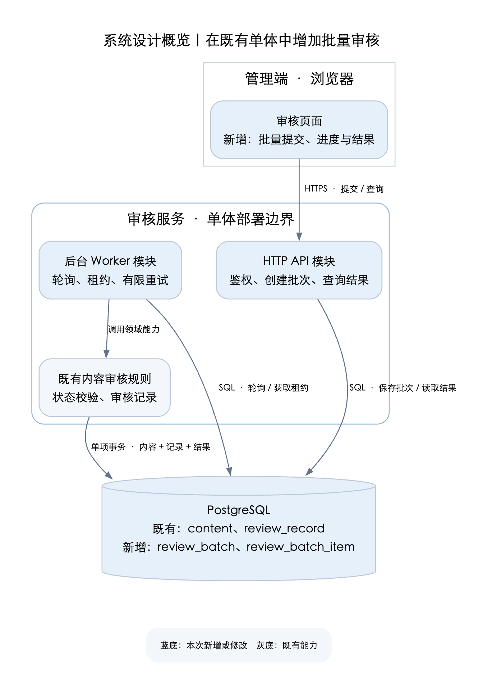
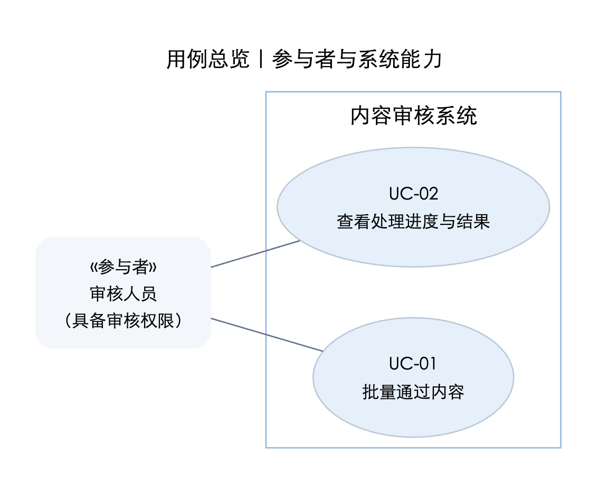
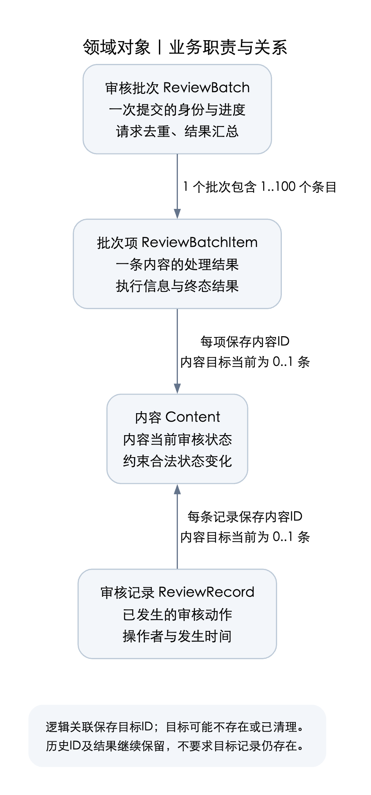
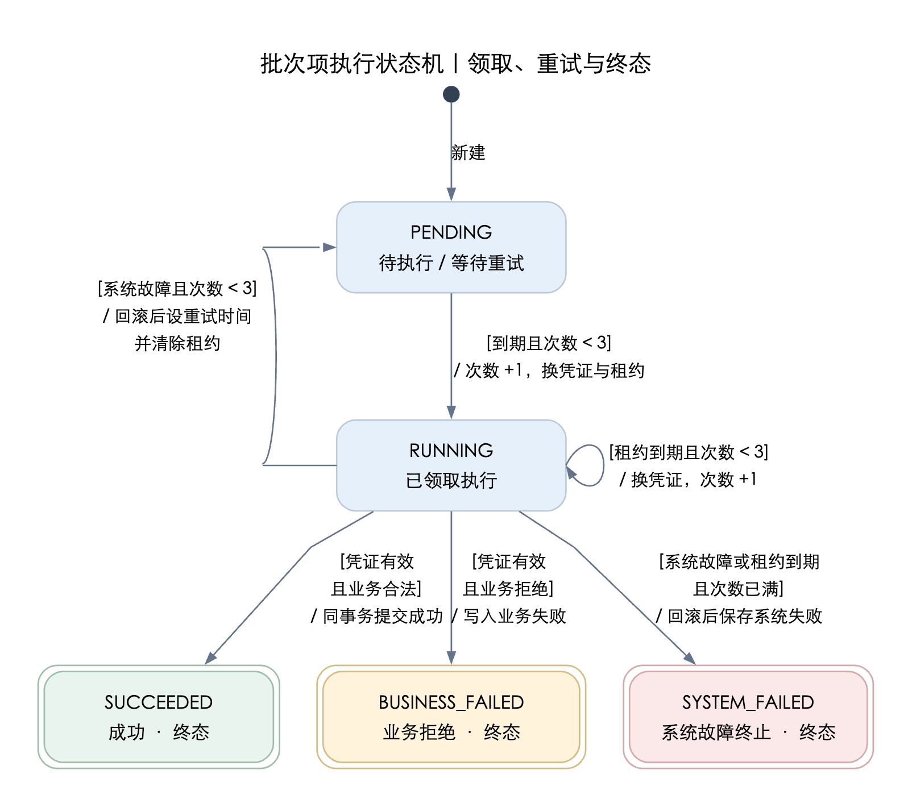
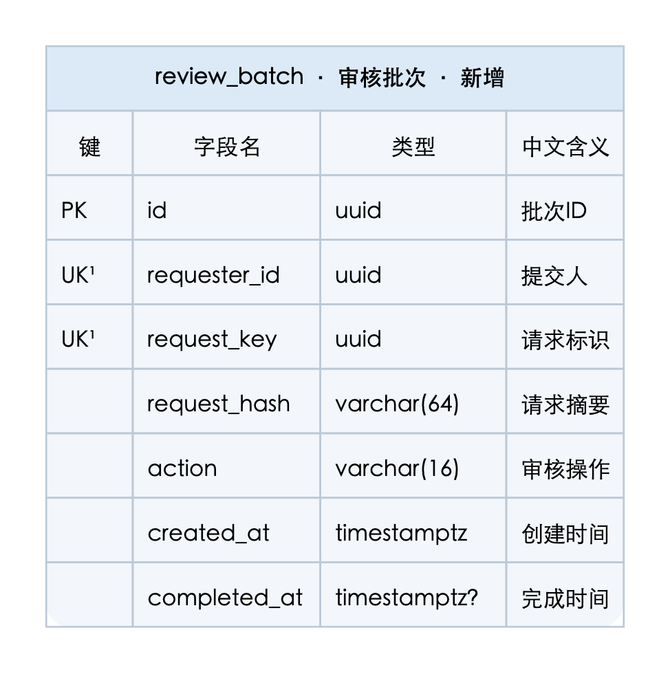
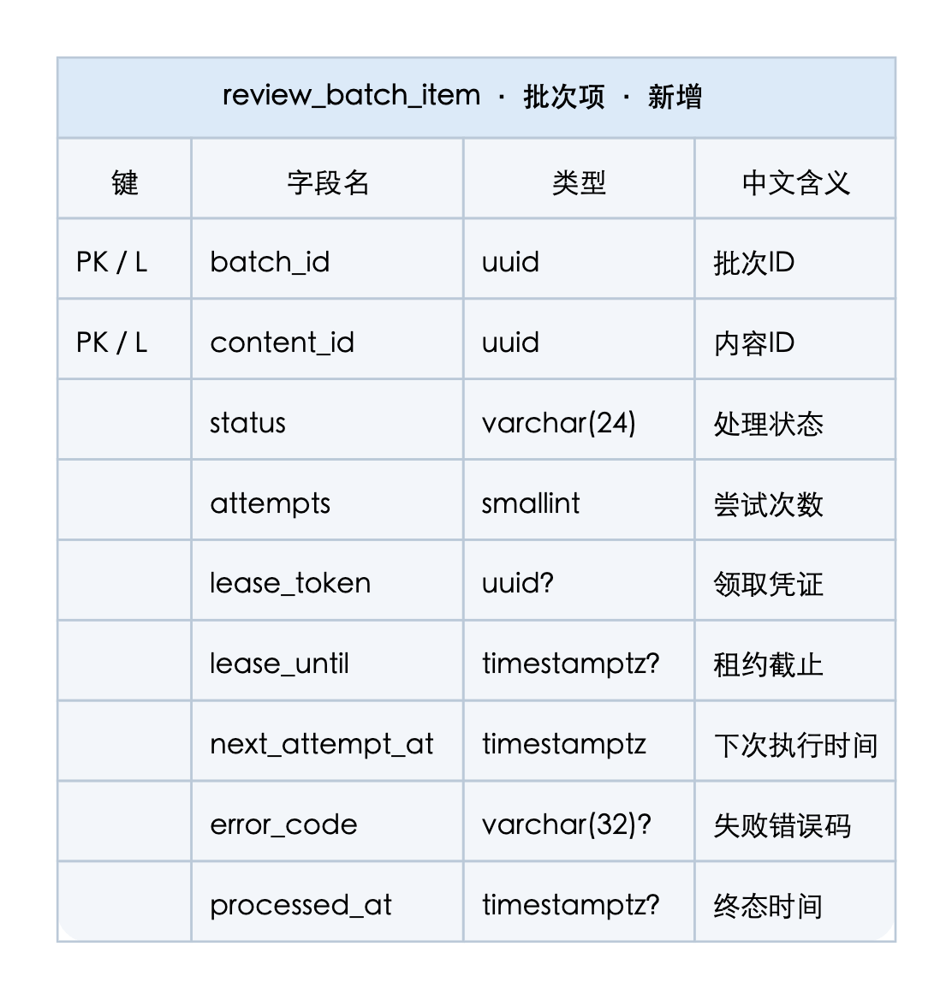
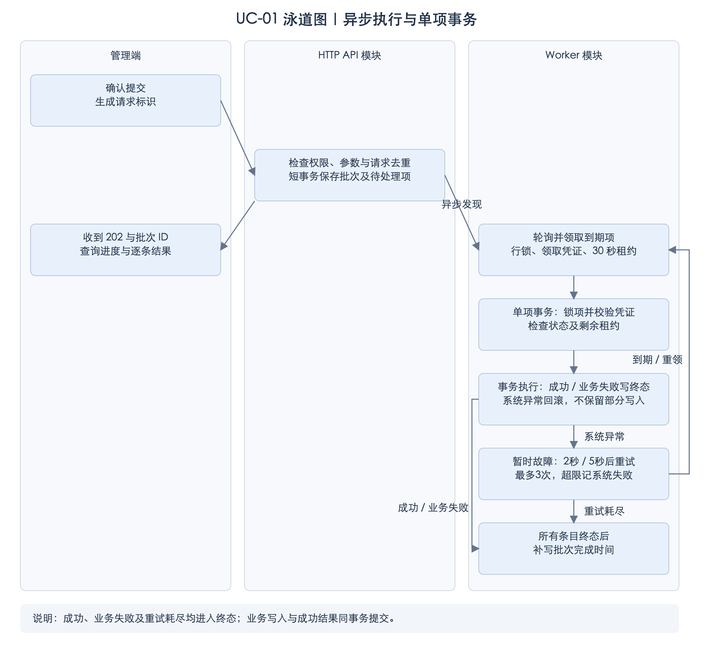

# 内容批量审核技术方案

> 教学样例 · 内容版 v12 · 日期：2026-10-21 · 虚构业务，仅作编写参考
> 需求来源：[示例需求](requirements.md)，版本 v1，见其“业务规则”“验收场景”和“非功能目标”章节。以下图与协议共同构成设计说明；需求规则只在需求文档维护。

本文为虚构教学项目，[已有系统输入](project-context.md)说明本例采用的入口、读取范围和状态写入者；推荐模块名不是仓库调研结果。正文展示方案本身，实际项目应以真实证据替换教学输入。

## 1. 背景与目标

审核人员希望一次提交多条内容，并在离开页面后查看结果。业务范围和验收场景见需求文档，本方案不重复定义。

异步处理和结果找回来自 R-02、R-04、R-06，因此提交需要一个可持久识别的批次；逐条独立结果和原子保存来自 R-02、R-07，决定了批次调度与单条审核需要分别承担职责。需求中的响应、处理时效和恢复目标同时约束这一划分。

推荐使用持久化批次：接口接收请求后返回批次编号，执行进程定期从数据库领取待处理项，逐条完成审核。前端按批次查询进度。这样提交响应不依赖整批耗时，进程中断后也能接着处理。

本方案的技术目标是保证请求可去重、单条审核和结果一致、执行中断可恢复。本教学样例假设已有管理端、单体审核服务和 PostgreSQL，尚无已投入运维的消息队列；设计沿用该边界，在已有应用与数据库内完成处理；执行组织见第4节，成立条件见第8节。

业务规则和时效目标来自示例需求；批次/条目划分、数据库领取以及后文的技术参数是本方案推荐。30秒租约、轮询间隔和并发数是待验证初值，不能因写入协议或验证表就视为已测量事实。已有能力属于教学输入，不是这些推荐反过来证明的项目现状。



管理接口负责认证、批次创建和查询；执行进程负责领取与重试；内容审核服务负责状态检查及原子更新。数据库既保存业务事实，也保存本次任务的进度。图中具体服务边界为本样例设定。

本例参与者从已有审核列表取得必要信息。该读取入口按当前 `content.review` 提供本租户审核字段，和R-01资格相容，不依赖普通内容浏览权限。受影响事实是内容审核状态及审核记录；已知单条、开放API通过和草稿提交的写入边界见教学输入，第4节在这些既有行为与新批量执行之间确定共同职责。

## 2. 用例总览

从需求中的审核人员目标提取两个用例：发起一组审核、找回并理解这组审核的结果。接收请求、领取任务和写数据库都是系统完成目标的内部步骤，不另立为用户用例。这里确定的完成结果将作为第 3 节分析正常与异常行为的依据。



| 编号 | 参与者目标 | 成功结果 |
| --- | --- | --- |
| UC-01 | 审核人员批量通过内容 | 最终为每条内容留下成功、业务失败或系统错误的明确结果。 |
| UC-02 | 审核人员查看处理结果 | 查看进度，区分成功、业务失败和系统错误。 |

执行进程是系统内部机制，不画成业务参与者。重新选择失败项提交仍属于 UC-01。

## 3. 用例分析

先按第 2 节的参与者目标说明可观察行为，再识别完成这些行为需要的内部职责。R-02、R-06 使“提交已接收”和“审核已完成”必须分开；R-07 使成功结果必须与实际审核动作一致。这些分析结果用于下一节划分内容审核与批次处理的职责。

### UC-01 批量通过内容

**触发与前提：** 具备审核权限的人员经已有审核读取入口选择本租户内容并确认，所需信息在其实际权限内可得。数量及去重规则引用R-01、R-04。批次接受后，执行者使用已保存的提交身份而非浏览器实时会话，授权时点沿用R-05。

**主流程：**

1. 审核人员确认选中的内容；页面为本次确认生成请求标识并提交。
2. 系统检查权限、数量和重复请求，接受提交并返回批次编号；页面打开该批次的结果地址，展示“处理中”。
3. 系统异步逐条审核，在实际处理时重新检查内容状态；一条失败不阻止其他内容完成。
4. 页面通过 UC-02 展示进度和逐条结果；全部条目得到终态后展示完成汇总。
5. 审核人员可以回到内容列表重新选择失败项发起新的提交；新的用户意图使用新请求标识。

| 对应步骤 | 分支 | 系统结果与恢复 |
| --- | --- | --- |
| 2 | 参数不合法或无权限 | 整体拒绝，不创建批次；页面展示可处理的原因。 |
| 2 | 重复标识 | 相同参数返回原批次；不同参数返回冲突，不自动换标识提交。 |
| 2 | 提交响应丢失 | 页面使用原标识和原参数重试，找回同一批次。 |
| 3 | 内容不存在或状态已变化 | 当前项业务失败，其他项继续；结果中保留对应内容 ID 和原因。 |
| 3 | 执行中断或可重试系统故障 | 系统恢复处理；达到 R-06 的尝试上限后，该项显示系统错误。 |
| 3～4 | 数据库不可用，结果也不能保存 | 不伪造终态；依赖恢复后继续处理。查询失败时页面保留已有结果，允许重试。 |

**完成后状态：** 每项都能解释其结果；成功项对应内容通过及审核记录，失败项没有本次审核成功的副作用。提交已接收是中间状态，不表示本用例已完成。已接收任务按 R-05 的提交时授权执行，后续权限变化不撤销任务。

### UC-02 查看处理结果

**触发与前提：** 提交返回后进入结果页，或通过已保存地址、浏览器历史重新打开；用户仍具有审核权限且为批次提交人。

1. 页面从管理端地址 `/review/batches/{batchId}` 读取批次 ID 并查询。
2. 系统检查当前权限及批次归属，返回全部条目和由条目汇总的结果。
3. 页面区分成功、业务失败和系统错误；有未完成项时每 2 秒查询。
4. 30 秒后仍未完成则提示“仍在处理，可稍后查看”；全部终态后停止轮询，展示完成汇总。

不存在或不属于调用人的批次统一返回不可访问；权限已撤销返回无权限。网络错误保留已显示结果并允许重试。结果地址支持刷新和收藏，本次不提供跨设备批次历史列表；用户须保存地址，页面不能承诺需求之外的查找入口。

**完成后状态：** 用户能找到该批次并理解当前进度或最终结果。完成意味着每项都有终态，不能等同于全部成功。

**共同职责与信息：** 接收时须取得提交身份和本次内容集合，实际成功须同时留下内容通过、审核记录及本项结果；失败须保留原因，每项进入终态须有完成时间。等待中的项尚无这些终态事实。因此后面可以把错误码及完成时间列设为可空，同时要求失败写入有错误码、终态写入有时间，查询按状态表达相同含义。

两个用例与既有单条、开放API通过共同改变内容状态及审核记录。原子审核已有负责者，批次只增加提交身份、结果和恢复职责；草稿提交不会将已通过内容改回待审。上述已定约定足够设计两个接口，不因轮询、租约等待验证初值而推迟请求与响应；性能验证只影响这些参数及其时效结论，不重新打开已定业务结果。

## 4. 领域对象设计

本次用例与相关既有生命周期共同确定两项能力：**内容审核**负责合法状态变化和审核记录，**批次处理**负责提交身份、查询归属及结果组织。教学输入中的管理端和开放API已共用内容审核能力；草稿提交只从草稿进入待审。新增批量及恢复也接入同一条件更新边界，不拥有另一套审核判断。

共同关系是一次成功通过必须来自当前待审核内容，并与对应审核记录一致；批量再将该条成功结果加入同一事务。既有条件更新与审核记录事务可以沿用，新增执行与条目保存接线尚待实现验证。参与者鉴权在可信入口完成，内容审核方法接收该入口核实的身份；因此R-05的已接受授权能传入执行进程，不因调用同一方法而重新引入实时权限门槛。只有真实项目的其他写入者未知时，才在其接入或并发依赖前保留局部核实项，不把本教学输入中已明确的边界重新宣布未知。

**能力管理的概念与信息**

一次提交需要可找回的身份，逐条结果需要独立记录，并关联目标内容。内容当前状态描述现在，条目结果及审核记录描述本次已发生的事实，不能互相覆盖。由此得到以下概念：

| 概念及性质 | 事实与职责 | 生命周期及边界 |
| --- | --- | --- |
| 内容 Content，已有业务对象 | 保存当前审核状态，限定待审核内容才能通过 | 由内容审核能力改变；不保存批次调度状态 |
| 审核批次 ReviewBatch，一次提交 | 管理提交人、请求标识及创建时间；请求标识是批次属性，不另建请求实体 | 创建后提交身份不变，完成后按保留规则清理 |
| 批次项 ReviewBatchItem，本次逐条处理记录 | 管理处理状态、执行信息及终态结果，关联批次和目标内容 | 可独立领取和更新，终态不再改为待执行；历史结果不随内容后续变化改写 |
| 审核记录 ReviewRecord，已有业务记录 | 保存实际审核动作及操作者 | 与成功状态变化同时写入，按既有审计策略保留 |



[放大查看领域对象图](assets/domain.svg)。领取凭证、租约和尝试次数属于条目的执行上下文；汇总数由条目计算。API 中的错误对象是结果的组合表示，也不单独成为实体。逻辑关联目标可能不存在或已清理，保留 ID 与可查询目标的数量分别说明。

**枚举属性与含义**

下表定义本次设计使用的枚举。已有字段仅提供相关值时明确标为节选，不据此修改既有取值约束；新增枚举则列出完整集合。

| 领域属性 | 取值及中文含义 | 初值、空值与适用范围 |
| --- | --- | --- |
| `ReviewBatch.action` | `APPROVE`：审核通过 | 本版完整集合；创建时由必填请求明确提供，不自动补值，不允许空值。 |
| `ReviewBatchItem.status` | `PENDING`：待执行或等待重试；`RUNNING`：已领取执行；`SUCCEEDED`：成功；`BUSINESS_FAILED`：业务拒绝；`SYSTEM_FAILED`：系统故障终止 | 完整集合；创建为 `PENDING`，不允许空值；后三项为终态。 |
| `ReviewBatchItem.errorCode` | `CONTENT_NOT_FOUND`：内容不存在；`CONTENT_STATE_CONFLICT`：内容状态不符；`PROCESSING_ERROR`：系统处理失败 | 完整集合；初始为空，仅失败时有值。业务失败使用前两种，系统失败使用后一种。空值表示没有失败错误，不是第四个枚举值。 |
| `ReviewBatch.status`，计算属性 | `PROCESSING`：仍有未完成项；`COMPLETED`：全部条目已终态 | 完整集合；创建后为 `PROCESSING`，不允许空值，不单独落库。 |
| `Content.reviewStatus`，既有属性 | `DRAFT`：草稿；`PENDING_REVIEW`：待审核；`APPROVED`：已通过 | 这是教学输入中已知相关值的节选，既有完整定义未提供；本次仅将待审核变为已通过，不重定义其他状态或初值。 |
| `ReviewRecord.action`，既有属性 | 本次成功审核写入 `APPROVE`：审核通过 | 本次写入值明确且非空；既有动作全集未提供，不推断为只有这一种，也不改变旧记录定义。 |

**内容的业务生命周期**

教学输入已说明草稿提交为 `DRAFT → PENDING_REVIEW`；本次审核通过为 `PENDING_REVIEW → APPROVED`。既有状态全集未提供，处理时只匹配待审核条件，其余状态均不能通过本次审核。

| 事件及当前状态 | 规则与负责者 | 结果及副作用 |
| --- | --- | --- |
| 审核通过，`PENDING_REVIEW` | 内容审核能力按R-03检查；操作者取已接受提交的授权上下文R-05 | 原子变为`APPROVED`，写审核记录和本次成功结果 |
| 审核通过，当前状态不符合条件 | 同一内容审核能力检查，单条与批量入口共用 | 内容不变；本次批次项记业务失败，不产生成功审核记录 |

**执行与恢复的组织**

在第1节的应用与数据库边界内，执行模块从持久条目中领取工作，调用已有内容审核能力，再保存该条结果。条目兼作待执行记录，行锁、领取凭证及有限重试保护恢复过程；扫描和锁等待的代价由第8节验证。若现有能力不能满足目标，先说明证据和约束缺口，不自行扩展基础设施。

**批次项的执行生命周期**

内部状态完整集合：`PENDING`（待执行/重试）、`RUNNING`（已领取执行）、`SUCCEEDED`（成功）、`BUSINESS_FAILED`（业务拒绝）、`SYSTEM_FAILED`（系统故障终止）。后三项为终态。API将前两项映射为对外`PENDING`，后三项同名返回；内容业务状态不与执行状态混用。

**执行状态机流转图**



[放大查看状态机](assets/execution-state.svg)。图表示单个批次项的生命周期，初始进入等待；三种终态均不再领取，用户主动重提属于新批次。RUNNING的自循环表示租约过期后的重新领取，会更换凭证并增加尝试次数，不表示旧执行者可继续写入。

**执行状态转换条件**

下表补充图上各条转换的条件和副作用。普通执行、回滚后记录重试、过期恢复均须遵守第5节的锁和凭证校验；数据库不可用而无法保存状态时，不宣称转换已发生，交由后续恢复。

| 变化 | 条件与执行者 | 结果 |
| --- | --- | --- |
| 新建 → `PENDING` | 批次应用服务接受合法新提交 | 生成待处理项，尚未产生审核副作用。 |
| `PENDING` → `RUNNING` | 已到下次执行时间且尝试次数小于 3，执行模块原子领取 | 递增次数并生成新凭证及租约。 |
| `RUNNING` → 终态 | 当前凭证有效且租约足以完成事务，内容审核服务执行 | 成功原子保存内容、记录、结果；内容不存在或状态不符记录业务失败。 |
| `RUNNING` → `PENDING` | 当前执行者遇到可重试故障且次数未达上限 | 业务事务回滚，另行保存下一次执行时间并清除租约。 |
| 过期 `RUNNING` → 重新领取或 `SYSTEM_FAILED` | 恢复模块持有条目锁，旧租约已到期 | 次数未满时换新凭证继续；已达上限则记系统错误。 |
| `RUNNING` → `SYSTEM_FAILED` | 当前有效执行者发生第 3 次系统故障 | 业务事务回滚，另行持久化终态；不能把故障写成业务拒绝。 |

终态不再参与领取；用户主动重提创建新批次。数据库故障导致重试或错误结果无法保存时，依靠已有租约到期后恢复，不假称状态已经更新。

批次状态由“是否还有非终态项”得出，存储的完成时间只作完成快照。查询在同一数据库快照中读取条目，全部终态时以 `max(processed_at)` 返回完成时间；后台补写同一个值，避免条目已结束而批次仍显示处理中。

**协作与工程映射**

本例由批次应用服务协调操作，内容审核服务承接稳定规则，已能满足当前协作。只有 APPROVE 一种动作，不预建策略/工厂框架；状态转移可用明确约束和分支管理，不逐状态建类。未来出现实际不同算法或分散复杂行为时，再判断模式收益及成本。

下列是教学样例中的职责建议，模块均处于第1节的单体边界内，不代表真实仓库已有这些文件：

| 负责位置 | 承担的用例与规则 |
| --- | --- |
| 审核 HTTP 接口 | 从登录上下文取得操作者，完成提交和查询鉴权，映射应用操作 |
| 批次应用服务 | 创建或找回批次，校验同标识参数，限制查询归属，组织结果视图 |
| 执行模块 | 领取、凭证校验、有限重试与过期恢复；不重写内容规则 |
| 内容审核服务 | 复用单条状态规则，在同一数据库事务中完成内容更新和审核记录 |
| 批次存储组件 | 与审核服务共用单条事务保存结果，不自行判断内容是否可通过 |

因此，同一次提交由批次识别，同一条内容的审核合法性始终由内容能力决定。下面据这些信息的更新方式选择存储，而不按模块或概念数量建表。

## 5. 库表结构设计

根据第 4 节的数据归属，将批次身份和条目状态分别持久化；根据 UC-02 的结果恢复要求，结果不能只存在请求内存中。R-07 则决定内容、审核记录和成功条目必须处于同一数据库事务。租约及重试字段来自执行恢复方案，不是从接口字段直接复制而来。

**表与关系的必要性：** 本例选择新增批次和条目两张表：批次承载提交身份及去重，条目承载独立领取、更新和查询的逐条结果。若把所有条目塞进批次的一份JSON，多个执行者将竞争更新同一记录，独立约束与恢复也更难表达，因此当前并发语义支持拆为两表。样例未设已有通用批次结构，因此复用审核能力并新增这两张表。

审核历史复用既有审核记录；请求去重字段留在批次，尝试次数和租约留在条目，汇总按结果计算，不再增加请求映射、重试历史、汇总或额外任务表。表的划分依据更新、查询和保留方式，不改变内容审核规则的负责位置。

表间关系及既有表节选见 [完整ER关系索引](assets/schema.svg)。正文按新增表分开展示，保持字段、类型和中文含义可读。图例：PK为主键，批次项的两个PK共同组成联合主键；L为记录目标ID的逻辑关联；所有表均不创建数据库FK，UK¹表示联合唯一键 `(requester_id, request_key)`，`?`表示可空。





放大查看：[审核批次](assets/schema-batch.svg) · [批次项](assets/schema-item.svg)。关系索引的连线均为业务逻辑关联，不表示数据库约束；联合键含义见图例。

图中新增表展示完整字段；既有 `content`、`review_record` 仅展示相关字段。本样例假设内容状态和单条审核记录已经存在；本次为审核记录新增可空 `batch_id`，旧单条审核记录保持空值，新批量审核填写所属批次。所有表间关系仅保存对应ID并由业务逻辑维护，包括条目到批次的batch_id；禁止创建数据库FK，也不启用ORM生成FK或数据库级联。内容及批次清理后的历史ID按保留规则继续保存。

**枚举字段的存储值**

以下字段与图中同名列对应。使用 `varchar` 不改变它们具有有限取值的含义；本次新增的枚举字段由应用显式写入，不设置数据库默认值，取值范围以检查约束及应用校验共同保证。

| 字段 | 存储值及中文含义 | 初值与对应关系 |
| --- | --- | --- |
| `review_batch.action` | `APPROVE`：审核通过 | 非空，由必填请求写入；与领域及 API `action` 同值。 |
| `review_batch_item.status` | `PENDING`：待执行或重试；`RUNNING`：已领取执行；`SUCCEEDED`：成功；`BUSINESS_FAILED`：业务拒绝；`SYSTEM_FAILED`：系统故障终止 | 非空，应用初值 `PENDING`。API 将前两种映射为 `PENDING`，三种终态同名返回。 |
| `review_batch_item.error_code` | `CONTENT_NOT_FOUND`：内容不存在；`CONTENT_STATE_CONFLICT`：内容状态不符；`PROCESSING_ERROR`：系统处理失败 | 初始 `null`；失败时按第4节对应类别填写，API `items[].error.code` 原样返回；其他状态为空。 |
| `content.review_status`，既有字段节选 | 已知相关值：`DRAFT`：草稿；`PENDING_REVIEW`：待审核；`APPROVED`：已通过 | 本次读取待审核、成功写已通过；既有全集、初值和约束沿用原定义，不根据节选缩小合法集合。 |
| `review_record.action`，既有字段节选 | 本次写入 `APPROVE`：审核通过 | 新批量成功记录明确填写；既有动作全集及默认规则沿用原定义。 |

批次的 `PROCESSING`、`COMPLETED` 是第4节定义的计算状态，不新增状态列。领域、存储与API只有上述条目状态合并映射，没有其他隐含编码转换。

**初值、可空与状态约束**

| 字段组 | 创建时的值与可空要求 | 后续约束 |
| --- | --- | --- |
| 批次 `id`、提交人、请求标识、摘要、操作 | 均非空；服务端生成批次 ID、从登录态取提交人、校验请求并计算摘要 | 操作限定 `APPROVE`；这些值创建后不改写。 |
| 批次 `created_at`、`completed_at` | 创建时间取数据库当前时间；完成时间初始 `null` | 全部条目终态后补写完成时间，不能因缓存未补写而隐藏真实完成结果。 |
| 条目 `batch_id`、`content_id`、`status`、`attempts`、`next_attempt_at` | 均非空；初始 `PENDING`、0 次、创建时间即可领取 | 状态限第 4 节枚举，尝试次数 0～3；下次执行时间仅用于尚可领取项。 |
| 条目 `lease_token`、`lease_until` | 初始 `null` | `RUNNING` 必须同时有值；等待重试和终态必须清空。 |
| 条目 `error_code`、`processed_at` | 初始 `null` | 终态时间必填；业务或系统失败必须有错误码，其余状态错误码为 `null`。 |

图中的 `?` 表示允许空值，其余字段均非空；以上应用写入规则及可表达的数据库检查约束共同保护状态合法性。

| 约束或索引 | 用途 |
| --- | --- |
| `review_batch UNIQUE(requester_id, request_key)` | 并发请求去重；冲突后读取已有批次并比较请求摘要。 |
| `review_batch_item PRIMARY KEY(batch_id, content_id)` | 同批次内容唯一。 |
| 条目索引 `(status, next_attempt_at)`、`(status, lease_until)` | 分别查找到期任务及过期租约。 |
| 条目主键 `(batch_id, content_id)` 的前缀 | 已支持按batch_id查询和清理，不再重复建单列batch_id索引。 |
| 审核记录 `(batch_id, content_id)` 联合索引，batch_id为空的旧记录可不纳入 | 支持按批次和内容关联审核证据的排查查询；不增加关系表或FK。 |
| 条目状态、尝试次数检查约束 | 限定合法枚举，尝试次数为 0～3。 |

请求摘要使用 `APPROVE` 加排序后的内容 ID 计算，因此内容顺序不同仍为相同参数。最大尝试次数为 3，领取时原子递增；过期且达到上限的条目保存为系统错误，不再次执行业务。

**关联的业务维护**

批次应用服务在同一事务创建批次和全部条目，校验生成的batch_id及条目对批次的归属；提交阶段仅按第6节校验内容ID格式、数量及重复，不因某条内容不存在而拒绝整批。目标内容是否存在、是否允许通过在执行时逐条判定。条目不开放绕过批次创建的独立写入口。执行和恢复只修改已有关联条目。内容不存在时按第3节业务失败处理，历史内容ID不因目标清理而清空。关联ID采用同一种UUID类型，目标表ID主键支持查找；本例未提供按内容跨批次检索，不为条目content_id另建无查询依据的索引，未来增加该访问时再评估。

**事务与竞争处理**



批次应用服务保存提交与条目；执行模块领取后，内容审核服务与批次存储组件在同一条业务事务中保存审核及结果。下文分别说明领取和业务事务的约束。

领取使用短事务：`FOR UPDATE SKIP LOCKED` 选取条目，写入随机领取凭证、30 秒租约和尝试次数。每秒轮询，单进程并发数可配置，本样例初值为 4。

业务执行使用另一事务：先锁条目并检查领取凭证、`RUNNING` 状态以及数据库当前时间仍早于租约截止时间，再条件更新内容，写审核记录和条目结果。过期执行者的凭证失效后不得写入结果。业务事务超时设为 5 秒，且开始业务事务时剩余租约必须不少于 5 秒，否则放弃执行，等待过期重领，避免跨过租约继续写入。恢复领取会更换凭证，旧执行者即使恢复也无法落结果。网络等外部调用不进入该事务。

失败重试间隔为 2 秒、5 秒。进程崩溃导致租约过期也消耗一次尝试，这是为执行次数设置上界的明确代价。

业务事务回滚后，另行保存重试或系统错误也须锁定条目并校验当前凭证和有效租约；旧执行者不能把其他执行者的结果改回等待状态。若此时租约已过期或数据库仍不可用，不写新状态，交给恢复领取处理。

**事务边界依据：** R-02 要求逐条独立结果，因此采用逐条事务；整批回滚不满足该业务语义，不作为可选方案参与比较。

**迁移与清理：** 先创建新表与索引、为审核记录增加可空 `batch_id`，再部署接口和执行进程，无历史回填。条目到批次、审核记录到批次及内容均使用业务逻辑关联，不创建FK，不使用数据库级联；清理批次不删除审核记录，也不将历史批次ID清空。

每日按小批次事务锁定候选批次，只删除 `completed_at` 已写入且早于当前时间 90 天、全部条目仍为终态的记录；未补写完成快照的批次先补写，未完成批次始终不清理。应用在同一事务中先按batch_id删除条目，再删除批次行，随之解除该行保存的请求标识去重记录；不依赖FK或数据库级联。该流程与创建/执行入口保持一致，终态项不再领取且批次创建后不追加条目。该清理行为符合R-08。清理可以重入，锁冲突时跳过；故障只延长保留时间，不能扩大删除范围。回退应用时保留新增表，不删除已生成结果。

## 6. 交互 API 协议设计

接口边界来自第 3 节的交互：UC-01 的提交交互确认接收并取得批次身份；UC-01 的业务完成仍以全部条目进入终态为准，UC-02 负责获取持续变化的结果。因此采用提交和查询两个接口，响应按页面所需的批次视图组织，隐藏内部租约和重试调度字段。第 4、5 节的结果状态、归属与事务是协议承诺的实现依据。

| 用例行为 | 协议职责 | 页面行为 |
| --- | --- | --- |
| 确认提交、响应丢失后找回 | API-01 返回稳定批次 ID；原标识原参数重试取得同一批次 | 接收 `202` 后导航至管理端 `/review/batches/{batchId}`，显示处理中，不显示通过成功。 |
| 恢复结果、观察进度 | API-02 返回汇总及逐条终态；内部运行和等待重试统一为对外 `PENDING` | 有未完成项则每 2 秒查询；完成后停止；30 秒提示不改变业务状态。 |
| 区分失败并决定下一步 | API-02 返回稳定业务错误或系统错误码 | 展示原因；用户主动重提使用新请求标识，网络重试沿用原标识。 |

这两个路由是教学样例的新增协议，列表中的单条审核继续使用已有接口，界面不改变原单条操作。消费者和公共响应约定的接入核对见文尾。

### 公共约定

ID 为 UUID，时间为 ISO 8601 UTC 字符串。认证沿用现有登录协议。终态错误分业务原因和系统原因；整个请求失败使用 HTTP 错误响应，单条失败保留在批次响应中。`error: null` 表示无错误，时间未知为 `null`，集合为空为 `[]`。

### API-01 提交批量通过 · UC-01

```http
POST /api/review-batches
Authorization: Bearer <access-token>
Idempotency-Key: 550e8400-e29b-41d4-a716-446655440000
Content-Type: application/json
```

服务端检查 `content.review`，以当前用户为提交人，不接受客户端指定操作者。

| 参数 | 位置 / 类型 | 必填 | 含义与约束 |
| --- | --- | --- | --- |
| `Idempotency-Key` | Header / UUID | 是 | 本次确认的请求标识；网络重试保持原值。 |
| `action` | Body / string | 是 | 本版固定为 `APPROVE`。 |
| `contentIds` | Body / UUID[] | 是 | 1～100 个，不能重复。 |

```json
{
  "action": "APPROVE",
  "contentIds": [
    "11111111-1111-4111-8111-111111111111",
    "22222222-2222-4222-8222-222222222222"
  ]
}
```

新建和重复请求均返回 `202 Accepted`，只说明任务已接收；当前结果由查询接口提供。未完成批次不清理；完成后结果与去重记录至少保留 90 天，每日清理到期数据。清理后再次使用旧标识视为新请求，前端不得把超出保留期的旧请求当网络重试。

```json
{
  "batchId": "aaaaaaaa-aaaa-4aaa-8aaa-aaaaaaaaaaaa",
  "resultUrl": "/api/review-batches/aaaaaaaa-aaaa-4aaa-8aaa-aaaaaaaaaaaa"
}
```

| 返回字段 | 类型 / 必返 | 含义 |
| --- | --- | --- |
| `batchId` | UUID / 是 | 被接收的批次编号。 |
| `resultUrl` | string / 是 | 本站相对查询路径，不包含认证信息。 |

`resultUrl` 是 API 查询地址；浏览器结果页地址由 `batchId` 组成，两者用途不同。离页恢复按前述管理端路径进行。

| 条件 | HTTP / code | 页面处理 |
| --- | --- | --- |
| 未登录 | 401 / `UNAUTHENTICATED` | 重新登录。 |
| 无权限 | 403 / `FORBIDDEN` | 提示无权限，不自动重试。 |
| 数量、ID 或操作非法 | 400 / `INVALID_ARGUMENT` | 修正输入。 |
| 标识相同、参数不同 | 409 / `IDEMPOTENCY_CONFLICT` | 提示请求冲突，不自动换标识。 |
| 响应丢失或 5xx | 无可靠结果 | 使用原标识和参数重试，避免创建第二批。 |

### API-02 查询批次 · UC-02

```http
GET /api/review-batches/{batchId}
Authorization: Bearer <access-token>
```

路径参数 `batchId` 为必填 UUID。校验当前 `content.review` 和提交人归属；不存在或他人批次统一 `404 / BATCH_NOT_FOUND`。本版最多 100 项，一次返回全部结果，不分页。

`200 OK` 示例：

```json
{
  "batchId": "aaaaaaaa-aaaa-4aaa-8aaa-aaaaaaaaaaaa",
  "action": "APPROVE",
  "status": "COMPLETED",
  "createdAt": "2026-10-21T02:30:00Z",
  "completedAt": "2026-10-21T02:30:02Z",
  "summary": {
    "total": 2,
    "succeeded": 1,
    "businessFailed": 1,
    "systemFailed": 0,
    "pending": 0
  },
  "items": [
    {
      "contentId": "11111111-1111-4111-8111-111111111111",
      "result": "SUCCEEDED",
      "processedAt": "2026-10-21T02:30:01Z",
      "error": null
    },
    {
      "contentId": "22222222-2222-4222-8222-222222222222",
      "result": "BUSINESS_FAILED",
      "processedAt": "2026-10-21T02:30:02Z",
      "error": {
        "code": "CONTENT_STATE_CONFLICT",
        "message": "内容已不处于待审核状态"
      }
    }
  ]
}
```

| 字段 | 类型 | 业务含义 |
| --- | --- | --- |
| `batchId` | UUID | 批次唯一编号，必返。 |
| `action` | enum | `APPROVE`：审核通过，必返；与第4、5节同值。 |
| `status` | enum | `PROCESSING` 尚有未完成项；`COMPLETED` 全部有终态。 |
| `createdAt` / `completedAt` | datetime / datetime或null | 提交时间与全部完成时间。 |
| `summary` | object | 五类数量；`total` 等于其余四项之和。 |
| `summary.total` | integer | 必返，提交项总数。 |
| `summary.succeeded` | integer | 必返，成功项数量。 |
| `summary.businessFailed` | integer | 必返，业务失败项数量。 |
| `summary.systemFailed` | integer | 必返，系统失败项数量。 |
| `summary.pending` | integer | 必返，尚未终态项数量。 |
| `items` | array | 按 `contentId` 升序；包含全部条目。 |
| `items[].contentId` | UUID | 原提交内容 ID，必返；内容删除也保留该历史标识。 |
| `items[].result` | enum | `PENDING`、`SUCCEEDED`、`BUSINESS_FAILED`、`SYSTEM_FAILED`；内部运行和等待重试均映射为 `PENDING`。 |
| `items[].processedAt` | datetime或null | 终态时间；处理中为 `null`。 |
| `items[].error` | object或null | 失败含机器码及可展示文案；前端按机器码判断。 |
| `items[].error.code` | enum | 失败时必返；第5节 `error_code` 的三种值原样返回，含义见该字段定义。 |
| `items[].error.message` | string | 失败时必返；可展示说明。 |

以上顶层字段、条目字段均必返；仅明确允许 `null` 的值可以为空，不省略字段。

处理中响应示例（`200 OK`）：

```json
{
  "batchId": "aaaaaaaa-aaaa-4aaa-8aaa-aaaaaaaaaaaa",
  "action": "APPROVE",
  "status": "PROCESSING",
  "createdAt": "2026-10-21T02:30:00Z",
  "completedAt": null,
  "summary": {
    "total": 2,
    "succeeded": 1,
    "businessFailed": 0,
    "systemFailed": 0,
    "pending": 1
  },
  "items": [
    {
      "contentId": "11111111-1111-4111-8111-111111111111",
      "result": "SUCCEEDED",
      "processedAt": "2026-10-21T02:30:01Z",
      "error": null
    },
    {
      "contentId": "22222222-2222-4222-8222-222222222222",
      "result": "PENDING",
      "processedAt": null,
      "error": null
    }
  ]
}
```

`BUSINESS_FAILED` 包括 `CONTENT_NOT_FOUND`、`CONTENT_STATE_CONFLICT`；`SYSTEM_FAILED` 使用 `PROCESSING_ERROR`，提示“处理失败，可重新提交”。系统错误不能伪装成业务拒绝。用户主动重提使用新请求标识。

查询未登录、无权限分别返回 401、403。所有请求级错误使用统一结构：

| 字段 | 类型 / 必返 | 含义 |
| --- | --- | --- |
| `code` | string / 是 | 稳定机器错误码，供调用方判断。 |
| `message` | string / 是 | 可展示说明，不暴露内部异常。 |
| `traceId` | string / 是 | 本次请求的排查标识。 |

```json
{
  "code": "BATCH_NOT_FOUND",
  "message": "批次不存在或不可访问",
  "traceId": "trace-example-001"
}
```

**接口实施顺序：** 先固定本节协议，由服务端提供开发态 Mock API，前端通过真实 HTTP 请求完成提交、处理中和结果展示；随后接入数据库与执行进程，替换服务端模拟。开发态开关只在非生产环境开启；真实实现验收通过后删除模拟入口配置，保持同一路由协议。

## 7. 功能指标、监控与告警

**必要性与范围：** 本例新增异步执行及有限恢复，需要能发现执行故障和任务滞留，因此展开这两项；已有数据库健康监控及请求日志沿用项目能力，不新建通用监控平台。现有覆盖尚未核实，接入条件见文尾。

| 必要观测 | 口径与位置 | 提示/告警及动作 |
| --- | --- | --- |
| 系统错误结果 | 从持久条目及 `processed_at` 查询最近5分钟系统失败与终态总数，同一快照计算比例；刷新替换窗口，不累加重复扫描 | 示例初值：样本至少100且比例超过1%时由后端值班检查依赖；低流量时可直接查询失败项，实际阈值按已有告警策略确定 |
| 最老未完成项年龄 | 查询未终态项关联批次 `created_at`，取等待时间最大值，作为排查依据 | 本例不另设年龄告警；沿用项目告警策略，接入前核实是否覆盖，并确认阈值和持续窗口。60秒恢复领取不作为批次总年龄阈值；查询失败不视为0积压 |

结果分布已可从批次查询及持久条目取得，本例不额外建立运营统计任务。R-07 的结果一致性先由事务和 A-03 等验收保障，问题排查时按批次ID及内容ID关联成功项与审核记录；不默认每分钟全量联表巡检。运行巡检未纳入本方案；后续若需要，应以规模、风险及审计保留窗口为依据，另行判断。

日志沿用既有请求与执行日志，关联批次ID、内容ID、worker ID及尝试次数，不记录领取凭证，不将这些ID作为无限增长的指标标签。后端值班负责系统故障和滞留，数据负责人在结果异常时核查事务。采集失败不得伪装成无错误；这些采集与阈值均待接入验证。

## 8. 非功能指标

以下验证承接第3章动作的完成事实和失败边界；并发、恢复和容量场景沿用相同业务条件，再检查具体技术措施能否保证结果。

**必要性与范围：** 示例需求已明确提交/查询响应、处理时效与中断恢复目标，所以本节只展开这些约束。它们从第1节起就参与设计；权限、并发正确性及保留规则的行为验收直接引用相应用例、协议和A-01～A-06，不重复制造一套指标。

教学样例尚未确定机器规格、数据库数据规模和统计样本量，也没有运行测量；轮询、并发数和租约只是待验证初值。恢复的“60 秒”指恢复领取，前提是数据库健康且另有可工作的执行实例，不代表整批在 60 秒内完成。若仅部署一个实例，实例恢复耗时须单独计入条件；不能用本例机制承诺停机期间自动恢复。

| 关注点 | 设计措施 | 验证与判定 |
| --- | --- | --- |
| 提交、查询响应 | 提交仅写任务，查询最多 100 项，使用主键和唯一索引 | 在相同环境、10 批×100 条负载下分别统计 P95，按需求阈值判定；环境和样本量在验证前明确。 |
| 处理时效 | 每秒领取，限制并发，检查数据库锁等待 | 重复执行需求负载，统计从批次接收到全部终态的时间；95% 在 30 秒内结束。未满足时回查领取、执行耗时和锁等待，再调整第 4、5 节方案。 |
| 中断恢复 | 30 秒租约，到期重新领取，最多三次尝试 | 数据库健康且其他执行实例可用时，领取后终止当前进程，60 秒内恢复领取；另外观察处理结束，核对已完成项无重复动作。 |

上线前必须以 A-01～A-06 验证业务结果；编译通过或接口返回 202 不能代替异步审核成立。本文尚未实现，也未宣称任何运行指标已经达标。

**实施与验收交接：** 最早真实路径采用两条内容（一条待审核、一条状态冲突），从页面提交直到数据库与审核记录核对，再验证重复请求、中断和并发。发布先迁移后启用接口及执行进程；回退先停止领取、等待在途事务结束，再回退应用，保留批次和审核记录。未完成批次由兼容版本接续处理，不删除任务来掩盖积压。

**接入前提与验证边界：** 需核实既有审核/批次能力、各端入口、接口消费者和公共协议、数据库历史写入者及监控覆盖，再补齐实际运行环境与样本量。已有通用批次能力时优先评估复用，不直接照搬新增表。本文只完成静态设计和独立图稿检查，未实现真实审核、性能或恢复验收。

最早验证要证实“接收与完成分开，但成功动作、审核记录和结果同事务成立”，再检验重放、状态冲突及恢复。后续任务按这条用户路径与共享审核能力安排，不按八章拆分。协议准备与真实替换沿用本组负责人，模拟仅用于开发态；设计CR应引用本稿与需求v1的具体版本及裁决。本文仍待评审，不把本示例的静态核对当真实业务独立验收。
