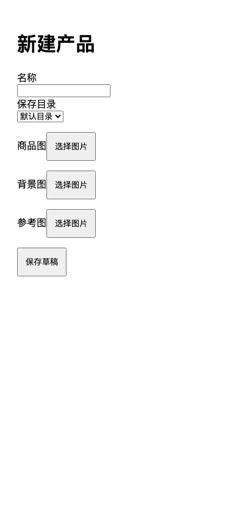
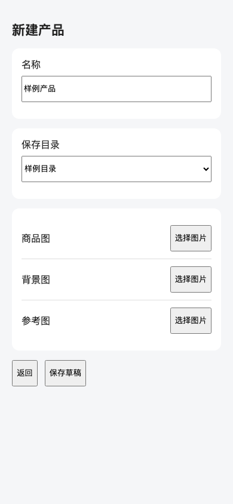
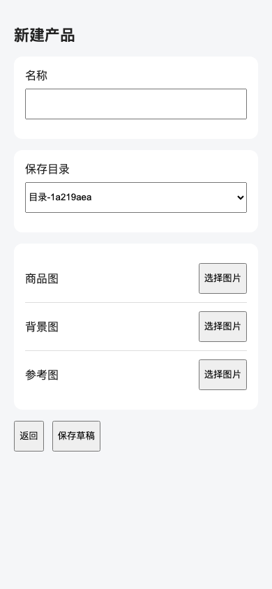
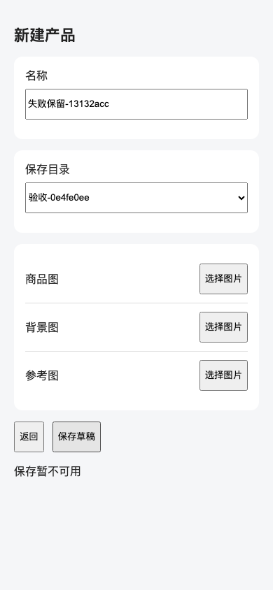

# 原型与服务端接入：实际执行回归

2026-10-17。两名独立冷启动子 Agent 分别完成任务 A、B，父线程独立运行浏览器验收并打开保存的截图。规则维护同时按 `skill-maintenance` 执行。此轮是隔离网页实际执行，不是策略推演，也没有运行旧新规则对照。

## 实际结果

| 场景 | 操作与观测 | 结果 |
|---|---|---|
| A：动态原型与服务端 Mock | 打开最终覆写原型；独立核对分组、输入高度、图片区三行右侧按钮和底部操作 | 通过，截图人工对照一致 |
| A：目录数据 | 评价者改变服务端随机目录名，正式页面显示新候选 | 通过 |
| A：保存与读回 | 页面 POST 保存、服务端内存核对、刷新 GET 后回显；再从页面外 POST 更新为另一名称，刷新采用新值 | 通过 |
| A：失败与返回 | 保存返回503，页面显示失败、保留输入、无假成功、存储不变；返回到原设置页 | 通过 |
| B：成熟接口小样式 | 只删除取消按钮28px覆盖，实际按钮均44px；既有/api/info请求及显示正常 | 通过 |
| B：范围 | 非目标源码与只读规则副本摘要未变，无额外文件或子目录 | 通过 |
| 原始未修夹具 | A布局、接入与保存失败；B的28px不等于44px | 按预期拒绝 |
| 缓存优先错误变体 | 保留实际POST/GET，但刷新优先读localStorage；仅“外部更新后读回”失败 | 按预期拒绝，说明新增检查能检出该错误 |
| 无关文档错误变体 | B按钮正确，但额外新增unrequested-guide.md | 按预期拒绝 |

评价者首次脚本有两处定位错误：下拉框名称包含选项文本，以及等待隐藏option可见。修复评价脚本后重新独立验证；这两处不算实现失败。只读审查另外发现缓存读回和文件范围漏检，补齐对应断言，并用上表错误变体检查判错能力。最后补查只读规则目录，避免范围检查只覆盖顶层。

两名执行者没有接收 `verify.cjs` 或另一任务的输入。A实际修改app.html/server.cjs，B只改settings.html；评价者未替它们修实现。完整条件、规则/源码摘要、逐项结果和错误变体差异见 [result.json](result.json)，实际产物见 [implementation.patch](implementation.patch)。自测脚本与截图不作为业务源码变更，A允许留存自测产物，B在副本外执行临时自测。

## 已实际打开的截图


最终动态覆写采用稿，390×844；验证字段分组、图片区三行右侧操作和底部按钮。


同视口实现；目录来自服务端，布局与采用稿对应。图片本次只实现布局，不证明上传能力。


服务端503后显示“保存暂不可用”，名称和目录保留。存储未变化与请求结果由浏览器操作及数据观测证明。


局部修改后两按钮均44px，原有服务名称保持显示。

## 复跑

从仓库根目录执行，环境需已有Playwright与Chromium；不要求安装新工具。设定 `PLAYWRIGHT_MODULE`、`CHROMIUM_EXECUTABLE` 后：

```sh
trial_dir=$(mktemp -d)
mkdir "$trial_dir/A" "$trial_dir/B"
for task in A B; do
  cp evals/delivery-behavior/execution/prototype-http/{server.cjs,api.js,app.html,settings.html,prototype.html,prototype-final.js} "$trial_dir/$task/"
done
patch -d "$trial_dir" -p1 < evals/delivery-behavior/results/20261017-prototype-http/implementation.patch
node evals/delivery-behavior/execution/prototype-http/verify.cjs A "$trial_dir/A" "$trial_dir/check-A"
node evals/delivery-behavior/execution/prototype-http/verify.cjs B "$trial_dir/B" "$trial_dir/check-B"
```

这是重放已保存产物，不是新的Agent执行轮次。新的行为回归需另开独立执行者、只提供选定任务与待测规则，再由评价者验收。

## 仓库检查

`bash scripts/check-playbook.sh` 通过：57项测试、458次断言，24组行为样例结构检查通过，Codex/Cursor现有链接正常；`git diff --check` 与新增脚本语法检查通过。结构检查与上面的两名Agent实际执行分别计数，不合并声称为26次行为通过。保存的补丁已在另一临时目录应用，源码摘要与实际验收版本一致。

## 证明边界

本轮只证明给定入口和候选规则下，这两个隔离场景完成了实际实现与检查。Mock使用隔离内存且无认证；不证明真实数据库、权限、微信原生或三端产品验收，不证明新规则比旧规则更快或普遍有效。所有自有服务和浏览器已停止，业务项目未改动，未提交或发布。

## 后续单例：接续时恢复采用入口

以上 A/B 保留当时的规则与评价快照；本节记录讨论收敛、触发条件收紧后的独立 C 轮次，不把 A/B 追溯为新规则验证。未作旧新规则对照。

独立冷启动执行者只接收任务目标、README/runtime 指针、三份候选规则及已有浏览器依赖。README 是本夹具唯一当前采用决定来源，明确浏览器390×844、v2 `/prototype`；带v1上下文的运行笔记仍映射到 `/prototype-v1`。旧页依旧200且保留原内容，API、认证边界与业务事实不变。未告知执行者哪处过期，也未要求它写入口说明。

执行者修改 app.html/server.cjs，未修改 README、runtime、采用稿或设置页。其留存的浏览器自测脚本实际访问 `/prototype` 作同视口几何对照。父线程另起服务、独立运行浏览器，7项检查通过：历史页未改且仍可打开、当前稿布局、服务端候选变化、保存刷新读回、页面外更新后读回新值、503保留输入且不假成功、返回原页。最终保存截图均实际打开核对。

另在同一产物上检查两个人为错误变体，不算新的Agent执行轮次：修改历史v1标识时保护检查拒绝，其余功能通过；给实现加上窄化内容区的样式时布局检查拒绝，HTTP路径仍通过。它们只证明这两个评价检查能检出对应错误。

准备差异见 [recovery-setup.patch](recovery-setup.patch)，实际实现见 [recovery-implementation.patch](recovery-implementation.patch)，输入、规则/源码摘要、自测脚本及独立结果见 [recovery-result.json](recovery-result.json)。旧历史页、当前稿、最终实现和503状态分别保存为以下图片：



历史v1保持原内容且可打开，不是404恢复。



当前v2有独立字段分组、三行右侧图片操作和底部返回/保存。



同视口实现符合当前v2；目录来自实际服务端响应。



503显示失败，名称和目录保留；存储及请求由独立运行观测核对。

复跑已保存产物（不是新的Agent轮次）：

```sh
recovery_dir=$(mktemp -d)
cp evals/delivery-behavior/execution/prototype-http/{server.cjs,api.js,app.html,settings.html,prototype.html,prototype-final.js} "$recovery_dir/"
patch -d "$recovery_dir" -p1 < evals/delivery-behavior/results/20261017-prototype-http/recovery-setup.patch
patch -d "$recovery_dir" -p1 < evals/delivery-behavior/results/20261017-prototype-http/recovery-implementation.patch
node evals/delivery-behavior/execution/prototype-http/verify.cjs C "$recovery_dir" "$recovery_dir-check"
```

该轮仅支持“一个可辨识过期映射、权威来源明确的场景能正确接续并运行”。不证明多来源产品冲突、三端恢复、真实认证/数据库、普遍自主整理能力或改善幅度。写不写说明不作为通过条件；所有自有服务和浏览器已停止，业务项目未改动，未提交或发布。

## 新旧规则收益对照

本节是另一次预先登记的对照实验，与上面的实际回归分开。运行前固定 [comparison-plan.json](comparison-plan.json)，由独立审查者确认输入与比较边界；结果见 [comparison-result.json](comparison-result.json)。没有根据中途结果调整任务、评价脚本或样本数。

旧规则使用基线 `b9e3a193c7620266cc6c5d9589c268d12be2d70f`，新规则为本次候选快照。四份产品输入逐字相同；规则快照每份53文件，组间只差本次四份规则。每次均是独立冷启动、同一父线程默认模型/推理设置（无覆盖）、同工具和依赖。只给任务及资料指针，不给旧映射位置、分组标签、评价脚本或历史结果。两轮分别按旧→新、新→旧顺序启动，每轮两例并行；全部交付后再顺序运行独立评价。

主要指标是首次独立验收通过数。每次7项冻结检查均通过，父线程打开同视口截图并对照采用稿。逐次结果如下；时间为执行者本地起止记录的墙钟区间，不是模型活跃时间或全部账户消耗。

| 轮次 | 试验 | 规则 | 首次独立验收 | 自计墙钟时间 | 父线程派发至收讯 |
|---|---|---|---|---|---|
| 1 | trial-1 | 旧 | 7/7，通过 | 56.10秒 | 80.41秒 |
| 1 | trial-2 | 新 | 7/7，通过 | 59.55秒 | 79.55秒 |
| 2 | trial-3 | 新 | 7/7，通过 | 57.62秒 | 88.60秒 |
| 2 | trial-4 | 旧 | 7/7，通过 | 64.01秒 | 138.43秒 |

旧规则首交2/2、新规则首交2/2，本场景未检出质量收益。旧组平均60.05秒，新组58.59秒，描述性差值1.47秒（约2.4%）；第一轮旧更快、第二轮新更快，每组仅2次，不能据此宣称稳定提效。四份规则整体比较，也不能把任何差异归到某一条文字。

没有可靠token遥测、内部返工次数或首次可用路径时间，均记缺失。评价者返修因实验不反馈修复提示而固定为0，不能作为减少返工的收益。父线程派发至收讯时间另存，含调度与等待，不替代执行成本。自测脚本、原始计时、独立检查及网络观测保存在结果JSON；每次产品补丁和已打开的实现/失败截图位于 `comparison/`。

这不是双盲实验：执行者不获知标签，评价者知道分组，使用冻结脚本和同一视觉条件降低解释偏差。共同全局元数据背景和强制读取本地快照也意味着它不测自动skill触发。各进程随机目录名/UUID不同，但项目输入、API语义和数据分布相同。

结论：本次补充验证支持两版在这个明确权威来源、单处过期入口场景都能完成任务，没有验证出新增规则带来的质量或稳定效率收益；不能反推真实三端无效，也不能继续声称已经证明流程更优。不因结果不显著继续扩样或更换场景。

归档复核：trial-3源码末尾没有换行，初次生成补丁时缺少相应标记，导致复放摘要不同；已仅修正补丁格式，四份产物均可准确复放。执行代码、首次评价和原始计时未修改。父线程派发至收讯与执行者自计区间的差异无法可靠拆分为排队、工具等待或末尾工作，不能用任一项冒充模型活跃成本。
