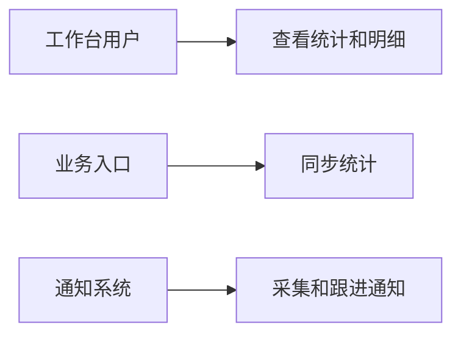
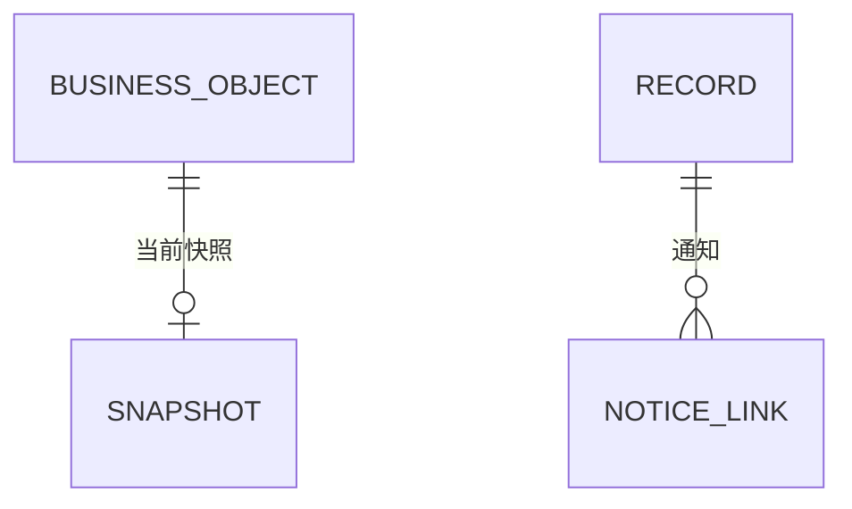

# 完整方案评审样例：运营工作台底座

本样例由一次失败方案的相关片段抽象而成，保留原稿的组织方式和缺口；名称、接口及字段已泛化，不是原稿全文。原稿有八章，已完成业务正确性评审并曾得到“可以拆任务”的结论。

## 背景与目标

业务提交后同步更新统计快照；工作台人员查看整体及组织统计并下钻到明细；请求与通知异步采集，通知成功后产生可跟进记录。采集暂停不影响业务统计，写入失败不改变业务结果。

## 用例总览

| 用例 | 结果 |
| --- | --- |
| 同步统计 | 业务提交后更新快照 |
| 查看统计 | 统计与明细的筛选一致 |
| 采集与跟进 | 通知成功后可处理 |

## 用例分析

业务提交后入口调用统一服务，信息不足时读取业务信息；服务更新快照，失败不改变业务结果。通知发送成功后保存处理记录；先后到达的信息按请求关联标识合并。处理人员可以接手、备注和解决，并发操作检查版本。

## 领域对象设计

业务对象保存权威数据；统计快照保存当前统计字段；采集记录承载请求和通知信息；通知链接指向采集记录。一个记录可以对应多个通知链接。

## 库表结构设计

| 表及字段 | 类型、约束、含义 |
| --- | --- |
| `snapshot` | `env`、`source_id`、`status`、`metrics jsonb`；按业务对象唯一。 |
| `record` | `id uuid`、`correlation_id uuid NULL`、`alert_status`、`owner_id`、`version integer`；记录请求和通知信息。 |
| `notice_link` | `id uuid`、`record_id uuid`、`sent_at`。 |

## 交互 API 协议设计

| 接口 | 输入 | 返回与错误 |
| --- | --- | --- |
| `GET /summary` | 维度、时间 | 总数和状态分组 |
| `GET /items` | 同 summary，可分页 | 明细和下一页 |
| `POST /records/:id/actions` | action、版本、可选内容 | 更新记录；冲突返回 409 |

## 功能指标、监控与告警

记录采集暂停、恢复及同步失败；异常通知沿用现有通道。

## 非功能指标与交接

采集写入不得改变业务成功结果。首条真实业务接入点及实际运行条件待验证；按底座能力拆任务。
