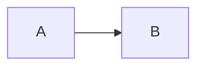

# <功能名称> 技术方案（轻量）

> 日期：YYYY-MM-DD
> 目标项目：`<project>`
> 状态：草案 / 定稿
> 需求说明：一句话或 `requirements.md` 路径（如有）

> 本模板用于**非复杂方案**：小改、单接口、单页面字段、局部 refactor。
> 改变关键共享规则、存在不可逆影响或高影响未知时，按 `references/stages/plan.md` 扩大相关设计；不按文件或技术名词计数。

## 1. 目标与非目标

- 用户成功场景：谁做什么，最终在哪里使用什么结果：
- 要做什么：
- 不做什么：

## 2. 证据来源

【按轻量阶段实际取得本次判断所需定义，将其具体名称和结论直接用于后文改动，再写尚缺部分及影响。少量事实可用一两句代替下表；缺口依据相关位置的查找结果，未读取不写成项目未提供。】

| 依据 | 本次已能确定的结论 | 尚不能确定的部分及影响 |
| --- | --- | --- |
| | | |

## 3. 改动范围

- 相关端 / 模块 / 文件：
- 是否改变共享契约、权限或状态规则；后续依赖与影响：

## 4. 方案说明

- 本次采用的完整定义：本次改变或实际依赖属性、输入输出的含义、类型、取值全集及逐值中文、产生条件、初值与省略/null；动作条件/结果、查询含义及实际结构。完整旧定义可精确引用，所引内容缺失就在此补齐，不能只引用类型名后让接手者猜含义；没有此类依赖则省略：
- 主思路与改法（3～5句）：采用上述定义，说明改哪里及如何实现，保留未变规则：
- 可选流程图：

## 5. 变更清单

| 类型 | 变更 |
| --- | --- |
| API | |
| DB | |
| UI | |
| 配置 / 脚本 | |

## 6. 测试与验收

- 最小自测：从合法起点给相配的调用→结果→变化与观察，同一组具体事实只维护一处；独立分支也有起点和请求。简单结果直接推得，非直观规则或多步集合按阶段方法局部核实；推演与工具验证分清，不另交文件、不强制样本表：
- 首个真实入口与消费者：
- 正式验证/审查范围：
- 最终验收：成功场景、受影响边界及未验证项：

## 7. 发布注意

- 是否需要 migration / env / 特殊发布步骤：

## 8. 待确认

- Pending 项（如有）：
